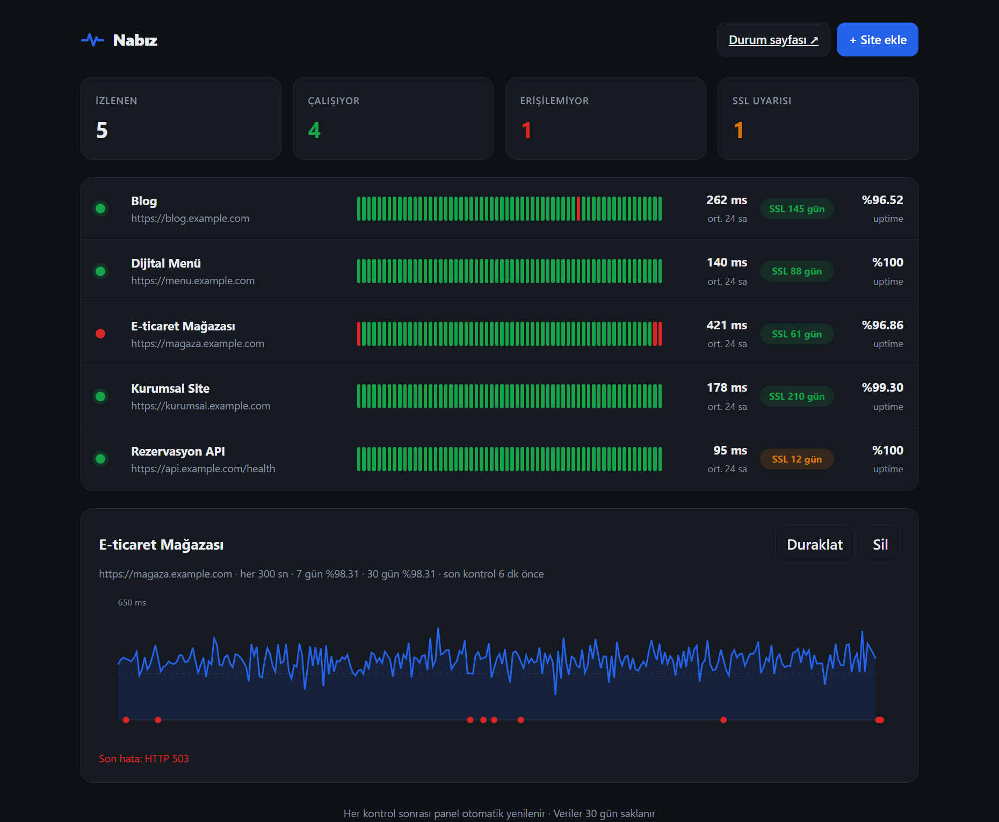
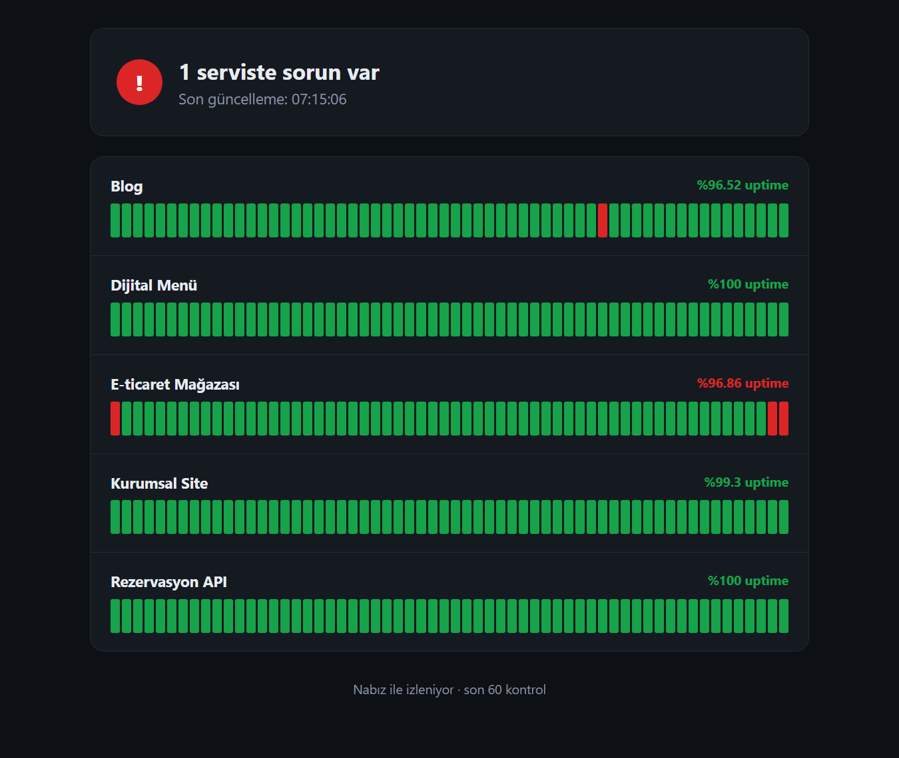

# Nabız — Site İzleme & SSL Takip Paneli

[](https://github.com/ilkertokat/nabiz/actions)


**Kendi sunucunuzda çalışan, bağımlılığı az bir uptime izleyici.** Sitelerinizi belirli aralıklarla kontrol eder; erişim, yanıt süresi, sayfa içeriği ve SSL sertifikasının bitiş tarihini takip eder. Bir site çöktüğünde ya da geri geldiğinde Telegram'dan veya webhook ile haber verir. Müşterilerinize gösterebileceğiniz herkese açık bir durum sayfası da içerir.

> *English summary below.*



## Neden?

Freelance olarak yönettiğim müşteri sitelerinin çalışıp çalışmadığını ve SSL sertifikalarının ne zaman biteceğini tek bir yerden görmek istedim. Hazır SaaS çözümleri ya ücretli ya da veriyi dışarı taşıyor. Nabız tek bir Python süreci ve tek bir SQLite dosyasıyla çalışır.

## Özellikler

- ⏱️ **Site başına kontrol aralığı** (10 sn – 1 gün), eş zamanlı kontroller için iş parçacığı havuzu
- 🔎 **Anahtar kelime kontrolü:** Sayfa 200 dönse bile beklenen içerik yoksa "çöktü" sayılır (ör. bakım sayfası)
- 🔐 **SSL takibi:** Sertifikanın bitmesine kaç gün kaldığı; 14 günün altında uyarı, süresi dolmuşsa kesinti
- 📈 **Panel:** 24 saat / 7 gün / 30 gün uptime, son 60 kontrolün durum çubuğu, yanıt süresi grafiği
- 🔔 **Akıllı bildirim:** Yalnızca durum *değiştiğinde* Telegram ya da webhook (aynı uyarı tekrar tekrar gelmez)
- 🌐 **Herkese açık durum sayfası** (`/status`)
- 🔑 **REST API:** Okuma serbest, yazma işlemleri isteğe bağlı `Bearer` token ile korunur
- 🧹 30 günden eski kayıtlar otomatik temizlenir
- 🐳 Dockerfile ve sağlık kontrolü · ✅ 24 birim/entegrasyon testi · GitHub Actions CI (Python 3.10–3.12)



## Hızlı başlangıç

```bash
pip install -r requirements.txt
python -m nabiz --port 8080            # http://127.0.0.1:8080
```

Demo verisiyle denemek için:

```bash
python scripts/demo_data.py demo.db
python -m nabiz --db demo.db --no-scheduler
```

Docker ile:

```bash
docker build -t nabiz .
docker run -d -p 8080:8080 -v nabiz-data:/data -e NABIZ_TOKEN=gizli nabiz
```

### Ortam değişkenleri

| Değişken | Açıklama |
|---|---|
| `NABIZ_DB` | SQLite dosya yolu (varsayılan `nabiz.db`) |
| `NABIZ_TOKEN` | Tanımlıysa ekleme/düzenleme/silme `Authorization: Bearer <token>` ister |
| `NABIZ_TELEGRAM_TOKEN`, `NABIZ_TELEGRAM_CHAT` | Telegram bildirimleri |
| `NABIZ_WEBHOOK_URL` | Durum değişiminde JSON POST atılacak adres (Slack/Discord köprüsü vb.) |

## API

| Yöntem | Uç | Açıklama |
|---|---|---|
| `GET` | `/api/monitors` | Tüm siteler ve özetleri (durum, uptime, ortalama süre, geçmiş) |
| `POST` | `/api/monitors` | Site ekle: `{"name", "url", "interval_sec", "keyword", "timeout_sec"}` |
| `GET` | `/api/monitors/<id>` | Tek sitenin özeti |
| `PATCH` | `/api/monitors/<id>` | Güncelle / duraklat: `{"paused": true}` |
| `DELETE` | `/api/monitors/<id>` | Sil (geçmişiyle birlikte) |
| `GET` | `/api/monitors/<id>/checks?hours=24` | Ham kontrol kayıtları |
| `GET` | `/api/summary` | Toplam / çalışan / çöken / SSL uyarısı sayıları |
| `GET` | `/health` | Sağlık kontrolü |

```bash
curl -X POST localhost:8080/api/monitors -H "Content-Type: application/json" \
     -d '{"name":"Mağaza","url":"https://ornek.com","interval_sec":60,"keyword":"Sepete ekle"}'
```

## Mimari

```
nabiz/
├── db.py          # SQLite katmanı (WAL, iş parçacığı başına bağlantı, cascade silme)
├── checker.py     # Tek kontrol: HTTP + süre + anahtar kelime + SSL (asla istisna fırlatmaz)
├── scheduler.py   # Arka plan döngüsü + ThreadPoolExecutor, durum değişiminde bildirim
├── notifier.py    # Telegram / webhook
├── app.py         # Flask: REST API, panel, durum sayfası
└── static/        # Bağımlılıksız HTML/CSS/JS arayüz (SVG grafik, karanlık mod)
```

Tasarım kararları:
- **Kontrol fonksiyonu saf ve test edilebilir:** HTTP istemcisi ve SSL sorgusu dışarıdan verilebiliyor; testler `httpx.MockTransport` ile ağa çıkmadan çalışıyor.
- **Bildirim yalnız geçişlerde:** Önceki ve yeni kontrol karşılaştırılıyor; uyarı yorgunluğu önleniyor.
- **Ön yüz çerçevesiz:** Derleme adımı yok; panel tek bir statik klasör.

## Testler

```bash
pip install pytest
pytest -q        # 24 passed
```

---

## English

**Nabız** ("pulse" in Turkish) is a small self-hosted uptime and SSL-expiry monitor. It checks each site on its own interval, records status code, response time and certificate expiry in SQLite, notifies via Telegram or a webhook **only when a site changes state**, and serves a dashboard plus a public status page. Built with Python, Flask and httpx; fully tested (24 tests) with GitHub Actions CI and a Dockerfile.

Run it with `pip install -r requirements.txt && python -m nabiz`, or try the demo with `python scripts/demo_data.py demo.db && python -m nabiz --db demo.db --no-scheduler`.

## Lisans

MIT © 2026 İlker Tokat
